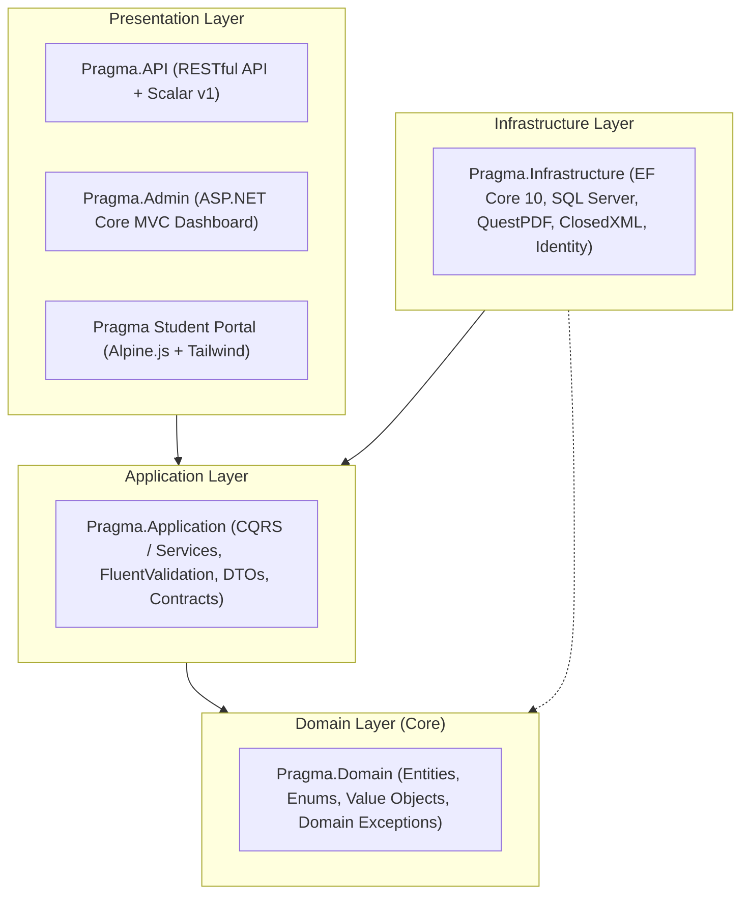

# 🎓 Pragma LMS — Müasir Tədris İdarəetmə Sistemi

[](https://dotnet.microsoft.com/)
[](https://learn.microsoft.com/dotnet/csharp/)
[](https://learn.microsoft.com/ef/core/)
[](https://tailwindcss.com/)
[](https://alpinejs.dev/)
[](https://xunit.net/)

**Pragma LMS** — .NET 10 və C# 14 platformasında **Onion Architecture** (Soğan Arxitekturası) prinsipləri əsasında layihələndirilmiş, yüksək dayanıqlı və müasir onlayn tədris platformasıdır. Sistem tələbə və müəllimlər üçün interaktiv video dərslər, YouTube 90% tərəqqi izləməsi, ClosedXML əsaslı dərəcə jurnalı, QuestPDF vektorlu sertifikat generatoru, Duolingo üslubunda Gamifikasiya (Streak, XP, Badges) və Google Gemini süni intellekt mentoru təklif edir.

---

## 🏛️ Arxitektura (Onion Architecture)

Sistem Domain-Driven Design (DDD) və Onion Architecture prinsiplərinə uyğun olaraq 5 layihədən ibarətdir:



### Layihə Qatları və Məsuliyyətləri:
1. **`Pragma.Domain` (Özək Qat):** Heç bir xarici paketdən və ya framework-dən asılı deyil (Zero Dependencies). Təməl Entity-lər (`Course`, `Module`, `Lesson`, `Quiz`, `Enrollment`, `UserStreak`, `UserBadge`, `Certificate`) və Enum-lar burada saxlanılır.
2. **`Pragma.Application` (Tətbiq Qatı):** Biznes məntiqi, servis interfeysləri (`ICourseService`, `IGradebookService`, `IAiMentorService`, `ICertificateService`), FluentValidation yoxlayıcıları və DTO modelləri.
3. **`Pragma.Infrastructure` (İnfrastruktur Qatı):** SQL Server `AppDbContext`, ASP.NET Core Identity, JWT generator, QuestPDF diplom dizayneri və ClosedXML Excel ixracatçısı.
4. **`Pragma.API` (Web API Qatı):** Minimal və Controllers əsaslı RESTful servislər, Scalar OpenAPI sənədləşməsi, təhlükəsizlik və Global Exception Middleware.
5. **`Pragma.Admin` (İnzibatçı Paneli):** Müəllim və Menecerlər üçün kurs, tələbə və qiymətləndirmə idarəetməsi (ASP.NET Core MVC + Bootstrap 5).

---

## 🌟 Əsas Funksional İmkanlar

| Modul | Funksionallıq | Texniki Həll |
| :--- | :--- | :--- |
| 🎬 **Sinema Video Pleyer** | YouTube inteqrasiyası, video fasiləsiz yadda saxlama, saniyəyə sıçrayış | YouTube IFrame API + LocalStorage + REST API |
| ⚡ **90% İzləmə Qaydası** | Dərsin tamamlanması üçün ən azı 90% baxış şərti | Backend Fluent Validation + Real-time Tracker |
| 📝 **Ağıllı Vaxt Qeydləri** | Videonun dəqiq saniyəsinə bağlanan qeydlər | FluentValidation + One-Click Timestamp Jump |
| 📊 **Excel Qiymət Jurnalı** | Bütün kurs üzrə 3 vərəqli analitik hesabat (.xlsx) | ClosedXML + Formula Injection Protection |
| 🎓 **QuestPDF Diplom** | Vektorlu, çapa hazır rəsmi PDF diplom və QR kod | QuestPDF + Dinamik Doğrulama URL-i |
| 🔥 **Gamifikasiya** | Gündəlik öyrənmə zənciri (Streak), XP xalları, nailiyyət nişanları | `UserStreak`, `UserBadge`, Leaderboard API |
| 🤖 **Gemini AI Mentor** | Dərs üzrə sual-cavab və kvizlər üçün Sokratik ipucu | Google Gemini API + Context-Aware Fallback |
| 📹 **Canlı Dərs Otağı** | Təhlükəsiz və qorunan video konfrans otaqları | Jitsi Meet deterministik otaq inteqrasiyası |
| 🌐 **Çoxdilli Portal** | Azərbaycan, İngilis və Rus dillərində anlıq interfeys | Alpine.js i18n Dictionary |

---

## 🔑 Test Hesabları və İlkin Məlumatlar (Seed Data)

Sistem ilk dəfə işə düşdükdə zəngin və real həyat ssenarisinə uyğun seed məlumatları ilə avtomatik təmin olunur:

| Rol | Ad Soyad | Email | Şifrə | Xüsusiyyət |
| :--- | :--- | :--- | :--- | :--- |
| **SuperAdmin** | Pragma SuperAdmin | `admin@pragma.edu.az` | `PragmaAdmin2026!` | Tam inzibati idarəetmə hüququ |
| **Müəllim** | Rəşad Əliyev | `teacher@pragma.edu.az` | `Password123!` | Kurs və kviz yaradıcısı |
| **Tələbə 1** | Əsmər Babayeva | `student@pragma.edu.az` | `Password123!` | 100% bitirilmiş kurs, rəsmi diplom sahibi |
| **Tələbə 2** | Leyla Qasımova | `leyla@pragma.edu.az` | `Password123!` | 7 günlük Streak, 210 XP, Liderlər Cədvəli #1 |
| **Tələbə 3** | Əli Məmmədov | `ali@pragma.edu.az` | `Password123!` | 3 günlük Streak, 75 XP, Aktiv öyrənən |

> [!NOTE]
> Yalnız lokal Development üçündür; Production-da demo hesablar yaradılmır.

> **Hazır Sertifikat Kodu:** `PRAGMA-2026-CSHR-7X9B1` (Əsmər Babayeva üçün təsdiqlənmiş diplom).  
> **Açıq Təsdiq Linki:** `/api/certificates/verify/PRAGMA-2026-CSHR-7X9B1`

---

## 🚀 Quraşdırma və İşə Salma

### Tələblər:
* [.NET 10 SDK](https://dotnet.microsoft.com/download/dotnet/10.0) (və ya ən son .NET 10 preview/release)
* Microsoft SQL Server LocalDB və ya SQL Server 2022+
* Git

### Addım 1: Repozitoriyanı klonlayın
```bash
git clone https://github.com/your-username/PragmaLMS.git
cd PragmaLMS
```

### Addım 2: Layihəni qurun və testləri yoxlayın
```bash
# Həll faylını (.slnx) yığın
dotnet build PragmaLMS.slnx

# 49 ədəd Unit Testi işə salın
dotnet test PragmaLMS.slnx
```

### Addım 3: REST API və Tələbə Portalını işə salın
```bash
dotnet run --project src/Pragma.API/Pragma.API.csproj
```

* 🌍 **Tələbə Portalı:** [http://localhost:5298/portal/index.html](http://localhost:5298/portal/index.html)
* 📜 **Scalar API Sənədləşməsi:** [http://localhost:5298/scalar/v1](http://localhost:5298/scalar/v1)

### Addım 4: İnzibatçı MVC Panelini işə salın (Ayrı terminalda)
```bash
dotnet run --project src/Pragma.Admin/Pragma.Admin.csproj
```
* 🛡️ **Admin Paneli:** [http://localhost:5033](http://localhost:5033)

---

## 📡 Əsas RESTful API Endpoint-ləri

Bütün endpoint-lər kiçik hərfli (lowercase) və REST konvensiyalarına uyğundur:

```
POST   /api/auth/login                  -> İstifadəçi girişi (JWT Access Token)
POST   /api/auth/register               -> Yeni tələbə qeydiyyatı
GET    /api/courses                     -> Kursların axtarış və filtrasiyası
GET    /api/courses/{id}                -> Kurs detalları və kurrikulum
POST   /api/courses/{id}/enroll         -> Kursa qeydiyyat
POST   /api/progress/video              -> Video saniyə və 90% tərəqqi qeydi
POST   /api/notes                       -> Videonun saniyəsinə ağıllı qeyd əlavə edilməsi
GET    /api/notes/lesson/{id}           -> Dərs üzrə qeydlərin siyahısı
GET    /api/courses/{id}/gradebook/excel-> 3 vərəqli rəsmi Excel dərəcə jurnalı (.xlsx)
GET    /api/quizzes/{id}/take           -> İmtahan sualları (düzgün variantlar gizlədilir)
POST   /api/quizzes/{id}/submit         -> İmtahan cavablarının təhvili və qiymətləndirmə
POST   /api/ai-mentor/ask               -> Dərs üzrə Gemini AI Mentora sual verilməsi
GET    /api/ai-mentor/quiz-hint         -> Sual üzrə Sokratik metodla pedaqoji ipucu
POST   /api/certificates/generate       -> 100% bitirilmiş kurs üçün sertifikat generasiyası
GET    /api/certificates/{id}/download  -> QuestPDF vektorlu PDF diplom faylı (.pdf)
GET    /api/certificates/verify/{code}  -> İctimai sertifikat həqiqiliyi yoxlaması
GET    /api/gamification/stats          -> Şəxsi Streak, XP və Nişanlar statistikası
GET    /api/gamification/leaderboard    -> Ümumi Liderlər Cədvəli
GET    /api/live-sessions/{lessonId}    -> Canlı dərs Jitsi otaq linki
```

---

## 🧪 Test Strategiyası

Sistem **49 ədəd** avtomatlaşdırılmış unit və inteqrasiya testləri ilə qorunur:
* `CoreArchitectureTests.cs`: Domen bazası, FluentValidation və Result pattern yoxlamaları.
* `CourseAndQuizTests.cs`: Kurs validasiyası və kviz qaydaları.
* `LearningProgressAndExcelTests.cs`: 90% video baxış həddi, ClosedXML Excel təhlükəsizliyi (Formula Injection qoruması).
* `GamificationAndCertificateTests.cs`: Streak alqoritmi (ardıcıl gün bonusu, zəncir qırılması), QuestPDF başlıq analizi.
* `AiMentorAndServiceIntegrationTests.cs`: Sokratik ipucu məntiqi, deterministik Jitsi otaq generasiyası, 100% sertifikat tələbi və kviz bal hesabı.

---

## 📄 Lisenziya və Müəlliflik Hüququ

Bu layihə təhsil və nümayiş məqsədləri üçün hazırlanmışdır.  
Bütün hüquqlar qorunur © 2026 **Pragma LMS**.
